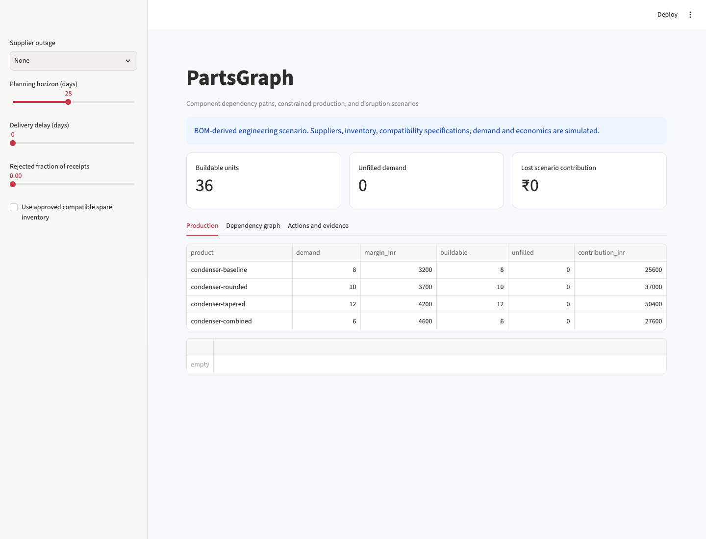

# PartsGraph

A component dependency and supplier-disruption study built from an existing condenser-design BOM. It traces shortages through nested assemblies and allocates shared stock under explicit demand and margin assumptions.



## What it does

- Bundled CondenserLab source BOM with component-level provenance.
- Validated directed acyclic BOM graph and recursive quantity expansion.
- Integer production allocation under shared part-stock and demand constraints.
- Supplier outage, delivery delay, rejected-receipt and planning-horizon scenarios.
- Approved-substitute checks for component kind, interface, voltage and temperature assumptions.
- Graph exploration, exact dependency paths, mitigation comparison, sensitivity analysis, GraphML, Excel and PDF outputs.

## Run locally

Python 3.12 is the tested runtime.

```bash
python3 -m venv .venv
source .venv/bin/activate
python -m pip install -e '.[dev]' -c constraints.txt
partsgraph run
streamlit run app.py --server.port 8512
```

Run these commands from this repository. For a non-editable installation or a different working
directory, set `PROJECT_ROOT` to the repository path. Raw downloads, local models and processed
datasets are ignored by Git; the run command regenerates them. Reports are included for review.
Network access is required for first-time public-data/model downloads where applicable.

`constraints.txt` records the dependency versions used in local validation. It is a tested version
constraint set, not a cross-platform hash lock. Ordinary dependency resolution still handles
platform-specific packages. Runtime dependencies are declared in `pyproject.toml`.

## Inspect the evidence

- analysis.pdf — scenario interpretation and limits
- supplier_risk.csv — spend versus lost scenario contribution
- dependency_paths.csv — product-to-shortage paths
- actions.csv — assumed mitigation costs and recoverable contribution
- dependencies.graphml — reusable dependency graph
- scenario_review.xlsx — review tables
- supplier_risk.html — standalone interactive comparison

Outputs live in `reports/`. [Read the generated analysis](reports/analysis.md),
[methodology](docs/methodology.md), [data dictionary](data/README.md),
and [validation record](docs/validation.json).

## Data and scope

Component names and descriptions come from data/source_bom.csv, copied from the existing CondenserLab study. The four product variants, nested chassis grouping, inventory, suppliers, compatibility properties, purchasing, demand, costs and margins are simulated assumptions. Four alternative source shrouds are mapped to one shroud per variant. No supplier quote, hardware fit approval or procurement savings is claimed.

Per-source download records store hashes and timestamps. A pre-existing local download is
identified as such if its original retrieval time was not captured. `data/provenance.json`
records the dataset and treatment assumptions. Refresh public sources explicitly when needed;
refreshing can change results.

## Walkthrough

1. Start with the healthy 28-day baseline: 36 units can be built.
2. Select the SealWorks outage. Only two seals remain, and the stock is shared across all products.
3. Enable compatible spare inventory. Buildable units increase to fourteen without duplicating stock.
4. Inspect the rejected 12V fan substitution against the scenario 24V requirement.
5. Compare supplier spend with disruption consequence and open the exact product/component paths.

## Validate

```bash
python -m pytest -q
python -m ruff check src tests
python scripts/verify_artifacts.py
```

Unit tests use small, interpretable fixtures. Artifact verification checks reconciliations,
report/workbook structure and generated-file hashes. Generate the data before running the
artifact verifier. The validation record distinguishes executed checks from deployment configuration.

## Container

After generating the project data, build from this repository:

```bash
docker build -t partsgraph:local .
docker run --rm -p 127.0.0.1:8512:8501 partsgraph:local
```

The build copies generated local inputs so the application can open them. Rebuild after
regeneration. Docker configuration does not itself establish a hosted deployment. Development
servers bind to local ports in these examples.

## Layout

```text
src/partsgraph/     analytical code, CLI and application
tests/                correctness and boundary fixtures
data/                 provenance, dictionary and regenerable inputs
reports/              measured results and shareable artifacts
docs/                 methodology, preview and validation evidence
scripts/              standalone artifact verification
```
